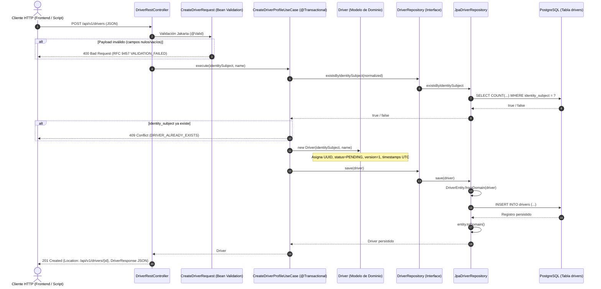

# Documentación Técnica: HU-01 — Crear Perfil de Conductor

**Microservicio M3: Conductores y Vehículos**  
**Trabajo Práctico Integrador — Desarrollo de Software 2026**  
**Tecnologías:** Java 21 · Spring Boot 3.3.4 · PostgreSQL 16 · Flyway · Docker Compose · Maven

---

> 💡 **Nota pedagógica y defensa oral:** Para una explicación didáctica basada en analogías cotidianas (la metáfora de la oficina pública), justificación de tecnologías elegidas, visión sistémica con otros microservicios y respuestas a preguntas típicas de la cátedra, consultar la **[Guía Explicativa de HU-01](HU01_Guia_Explicativa.md)**.

## 1. Visión General y Flujo de la Solución

La historia de usuario **HU-01 (Crear perfil de conductor)** permite registrar a un conductor en el sistema a partir de su identidad federada (`identity_subject`) y su nombre completo. Al momento de la creación, el perfil se inicializa en estado `PENDING` (pendiente de calificación y validación documental), con versión de auditoría y concurrencia optimista `version = 1`, asignándole un identificador único global `UUID` y marcas temporales de creación y actualización en UTC (`Instant`).

### 1.1 Arquitectura Hexagonal (Puertos y Adaptadores)

La solución respeta estrictamente los principios de **Arquitectura Hexagonal (Ports & Adapters)** y **Clean Architecture**:

* **Capa Externa / Adaptador Primario (Inbound):** Controlador REST (`DriverRestController`), DTOs de entrada/salida y manejador de excepciones global (`GlobalExceptionHandler` con RFC 9457).
* **Capa de Aplicación (Use Cases):** Caso de uso orquestador (`CreateDriverProfileUseCase`) y definición del puerto de persistencia (`DriverRepository`).
* **Capa de Dominio (Core):** Modelo puro (`Driver`), enumeraciones de dominio (`QualificationStatus`) y excepciones de negocio (`DriverAlreadyExistsException`), sin acoplamiento a frameworks (Spring, Hibernate, etc.).
* **Capa de Infraestructura / Adaptador Secundario (Outbound):** Implementación del repositorio (`JpaDriverRepository`), entidad JPA con anotaciones relacionales (`DriverEntity`) y repositorio de Spring Data (`SpringDataDriverRepository`).

### 1.2 Diagrama de Flujo de Ejecución



---

## 2. Explicación de Componentes Clave

### 2.1 Migración de Base de Datos: `V1__create_drivers_table.sql`
* **Ubicación:** `src/main/resources/db/migration/V1__create_drivers_table.sql`
* **Rol y Responsabilidad:**
  * Define el esquema relacional inicial gestionado automáticamente por Flyway en el arranque de la aplicación.
  * Establece la clave primaria `id` de tipo `UUID`.
  * Garantiza la **unicidad a nivel motor de base de datos** mediante la restricción `UNIQUE` en la columna `identity_subject`.
  * Define un índice `idx_drivers_identity_subject` para acelerar las consultas de búsqueda y validaciones de existencia previas a la inserción.
  * Agrega una restricción de comprobación `chk_qualification_status` (`CHECK (qualification_status IN ('PENDING', 'APPROVED', 'OBSERVED', 'REJECTED', 'SUSPENDED'))`) asegurando consistencia a nivel esquema.
  * Establece valores por defecto para `version` (1) y marcas temporales `created_at` y `updated_at` con `CURRENT_TIMESTAMP`.

### 2.2 Modelo de Dominio Puro: `Driver.java`
* **Ubicación:** `src/main/java/ar/edu/utn/frre/m3/domain/Driver.java`
* **Rol y Decisiones de Diseño:**
  * Representa la entidad raíz del agregado en el dominio. Es una clase **Java pura** sin anotaciones de Spring ni JPA (independiente de la infraestructura).
  * Encapsula los invariantes de negocio desde el momento de su instanciación:
    * El constructor de creación asigna un `UUID` aleatorio, valida que `identitySubject` y `name` no sean nulos ni vacíos mediante métodos estáticos internos de validación, define el estado inicial inmutable como `QualificationStatus.PENDING`, inicializa `version = 1` y sella los timestamps iniciales en `Instant.now()`.
    * Provee un segundo constructor para la reconstrucción limpia de la entidad proveniente de persistencia.
    * Implementa métodos de mutación controlada del estado (`updateName`, `changeQualificationStatus`, `incrementVersion`) actualizando automáticamente `updatedAt`.
    * Sobrescribe `equals` y `hashCode` basados en la identidad del conductor (`id` o `identitySubject`).

### 2.3 Puerto del Dominio: `DriverRepository.java`
* **Ubicación:** `src/main/java/ar/edu/utn/frre/m3/application/port/DriverRepository.java`
* **Rol y Responsabilidad:**
  * Define el contrato de persistencia requerido por la capa de aplicación sin filtrar detalles técnicos de PostgreSQL o JPA.
  * Declara métodos expresivos orientados al dominio: `findById(UUID id)`, `findByIdentitySubject(String identitySubject)`, `existsByIdentitySubject(String identitySubject)` y `save(Driver driver)`.

### 2.4 Caso de Uso: `CreateDriverProfileUseCase.java`
* **Ubicación:** `src/main/java/ar/edu/utn/frre/m3/application/usecase/CreateDriverProfileUseCase.java`
* **Rol, Transaccionalidad y Manejo de Concurrencia:**
  * Componente de servicio de aplicación anotado con `@Service` y `@Transactional`.
  * Orquesta la lógica del negocio:
    1. Normaliza los datos de entrada (trimeo de espacios en blanco).
    2. Comprueba si el `identity_subject` ya se encuentra registrado mediante `driverRepository.existsByIdentitySubject(...)`.
    3. Si ya existe, interrumpe el flujo y lanza la excepción de negocio `DriverAlreadyExistsException`, evitando duplicaciones.
    4. Si no existe, instancia la entidad de dominio `Driver` e invoca `driverRepository.save(newDriver)`.
  * También expone una sobrecarga que acepta el record `CreateDriverCommand` para comandos desacoplados.

### 2.5 Adaptador de Persistencia JPA: `DriverEntity.java` y `JpaDriverRepository.java`
* **Ubicación:**
  * `src/main/java/ar/edu/utn/frre/m3/adapter/persistence/DriverEntity.java`
  * `src/main/java/ar/edu/utn/frre/m3/adapter/persistence/JpaDriverRepository.java`
  * `src/main/java/ar/edu/utn/frre/m3/adapter/persistence/SpringDataDriverRepository.java`
* **Decisiones de Diseño:**
  * **Separación de Modelos:** `DriverEntity` es la clase con anotaciones `@Entity`, `@Table(name = "drivers")`, `@Id`, `@Column` y `@Enumerated(EnumType.STRING)`. No contamina el dominio con metadatos de Hibernate.
  * **Mappers Bidireccionales:** `DriverEntity.fromDomain(Driver)` transforma la entidad de negocio a entidad JPA y `entity.toDomain()` reconstituye la entidad de negocio.
  * **Adaptador de Salida:** `JpaDriverRepository` implementa la interfaz `DriverRepository` inyectando `SpringDataDriverRepository` (que extiende `JpaRepository<DriverEntity, UUID>`), sirviendo como puente transparente entre el caso de uso y la base de datos.

### 2.6 Adaptador Web REST y DTOs: `DriverRestController.java`
* **Ubicación:** `src/main/java/ar/edu/utn/frre/m3/adapter/rest/`
* **Componentes:**
  * **`DriverRestController.java`**: Expone `POST /api/v1/drivers`. Recibe la petición con validación declarativa `@Valid @RequestBody CreateDriverRequest`, delega al caso de uso, construye el encabezado `Location: /api/v1/drivers/{id}` y responde con `201 Created` y el cuerpo `DriverResponse`.
  * **`CreateDriverRequest.java`**: DTO de entrada. Implementa anotaciones Jakarta Bean Validation:
    * `@NotBlank` y `@Size(max = 255)` para `identitySubject`. Soporta alias JSON (`@JsonAlias({"identity_subject", "subject"})`) para compatibilidad tanto con `camelCase` como con `snake_case`.
    * `@NotBlank` y `@Size(min = 2, max = 255)` para `name`. Soporta alias JSON (`@JsonAlias({"fullName", "full_name", "nombre"})`).
  * **`DriverResponse.java`**: Java Record inmutable de salida que mapea los campos que el cliente debe consumir, incluyendo timestamps en formato ISO-8601 UTC.
  * **`GlobalExceptionHandler.java`**: Centraliza el tratamiento de errores mediante `@RestControllerAdvice` utilizando el estándar **RFC 9457 (ProblemDetail)**:
    * `DriverAlreadyExistsException` $\rightarrow$ `409 Conflict` (`code: "DRIVER_ALREADY_EXISTS"`).
    * `MethodArgumentNotValidException` $\rightarrow$ `400 Bad Request` (`code: "VALIDATION_FAILED"` junto con un mapa detallado de campos con error `invalidFields`).
    * `IllegalArgumentException` $\rightarrow$ `400 Bad Request` (`code: "INVALID_ARGUMENT"`).

---

## 3. Estrategia de Pruebas

El microservicio cuenta con una estrategia de pruebas en pirámide, asegurando tanto el aislamiento de capas como la integración de extremo a extremo:

| Nivel de Prueba | Clase | Alcance y Tecnologías |
| :--- | :--- | :--- |
| **Unitaria (Dominio y Aplicación)** | `CreateDriverProfileUseCaseTest` | Valida la lógica de negocio en completo aislamiento usando Mockito (`@ExtendWith(MockitoExtension.class)`). Verifica la creación con estado `PENDING`, versión `1`, timestamps, detección de duplicados lanzando `DriverAlreadyExistsException`, y validación de parámetros nulos/vacíos. |
| **Slicing Web (Controlador REST)** | `DriverRestControllerTest` | Prueba la capa HTTP de forma aislada usando `@WebMvcTest(controllers = DriverRestController.class)`. Simula el caso de uso con `@MockBean` para verificar serialización JSON, validaciones `@Valid`, códigos HTTP 201, 400 y 409 y header `Location`. |
| **Integración End-to-End (E2E)** | `DriverIntegrationTest` | Prueba el flujo completo desde el controlador hasta PostgreSQL y Flyway utilizando `@SpringBootTest(webEnvironment = RANDOM_PORT)` y `MockMvc`. |

### 3.1 Cobertura de `DriverIntegrationTest.java`

1. **Flujo de Creación Exitosa (`shouldCreateDriverSuccessfully`):**
   * Envía un JSON válido con `identitySubject` y `name`.
   * Comprueba la respuesta HTTP `201 Created`.
   * Verifica que el header `Location` esté presente.
   * Valida que el `id` sea un UUID no nulo, `qualificationStatus == 'PENDING'`, `version == 1` y que los campos de auditoría `createdAt` y `updatedAt` contengan fechas válidas.
   * Consulta directamente la base de datos para confirmar que el registro fue persistido correctamente.
2. **Flujo de Rechazo por Duplicado (`shouldRejectDuplicateDriverWith409Conflict`):**
   * Inserta un conductor inicial exitosamente.
   * Vuelve a enviar una petición con el mismo `identitySubject`.
   * Comprueba que la respuesta sea `409 Conflict` con el código de error `DRIVER_ALREADY_EXISTS`.
3. **Flujo de Validación de Campos Obligatorios (`shouldRejectInvalidPayloadWith400BadRequest`):**
   * Envía payloads vacíos o incompletos.
   * Comprueba que responda `400 Bad Request` con código `VALIDATION_FAILED` y el detalle de los campos inválidos.
4. **Limpieza e Independencia (`@AfterEach`):**
   * Elimina selectivamente los conductores creados durante cada test para garantizar que no existan efectos secundarios ni conflictos en ejecuciones repetidas.

---

## 4. Guía de Ejecución Local

### 4.1 Levantar PostgreSQL con Docker Compose

El repositorio incluye el archivo `compose.yaml` configurado con la base de datos PostgreSQL 16:

```powershell
# Levantar el contenedor de PostgreSQL en segundo plano
docker compose up -d postgres

# Verificar que el contenedor esté corriendo y saludable
docker compose ps
```

* **Host:** `localhost`
* **Puerto:** `5432`
* **Base de datos:** `m3_db`
* **Usuario:** `m3_user`
* **Contraseña:** `m3_password`

### 4.2 Compilar y Ejecutar el Microservicio

El servicio inicia en el puerto **`3003`** (configurado en `src/main/resources/application.yml`).

#### Ejecutar la Suite de Pruebas Automatizadas
```powershell
.\mvnw.cmd test
```

#### Iniciar la Aplicación Spring Boot
```powershell
.\mvnw.cmd spring-boot:run
```
*(En entornos Linux / macOS, utilizar `./mvnw spring-boot:run`)*.

---

### 4.3 Ejemplos de Requests y Respuestas

#### Caso 1: Creación Exitosa (`201 Created`)

**PowerShell (`Invoke-RestMethod`):**
```powershell
$body = @{
    identitySubject = "auth0|juan-perez-12345"
    name            = "Juan Perez"
} | ConvertTo-Json

Invoke-RestMethod -Uri "http://localhost:3003/api/v1/drivers" `
                  -Method Post `
                  -ContentType "application/json" `
                  -Body $body
```

**cURL:**
```bash
curl -X POST "http://localhost:3003/api/v1/drivers" \
     -H "Content-Type: application/json" \
     -d '{"identitySubject":"auth0|juan-perez-12345","name":"Juan Perez"}'
```

**Respuesta HTTP (`201 Created`):**
```http
HTTP/1.1 201 Created
Location: /api/v1/drivers/81045426-848e-43bc-9b6d-a223135e45be
Content-Type: application/json
```
```json
{
  "id": "81045426-848e-43bc-9b6d-a223135e45be",
  "identitySubject": "auth0|juan-perez-12345",
  "name": "Juan Perez",
  "qualificationStatus": "PENDING",
  "version": 1,
  "createdAt": "2026-10-07T17:19:20.642892700Z",
  "updatedAt": "2026-10-07T17:19:20.642892700Z"
}
```

---

#### Caso 2: Rechazo por Duplicado (`409 Conflict`)

Si se vuelve a enviar una petición con el mismo `identitySubject`:

**PowerShell (`Invoke-RestMethod` con captura de error):**
```powershell
try {
    Invoke-RestMethod -Uri "http://localhost:3003/api/v1/drivers" `
                      -Method Post `
                      -ContentType "application/json" `
                      -Body $body
} catch {
    $_.Exception.Response.GetResponseStream() | ForEach-Object { 
        (New-Object System.IO.StreamReader($_)).ReadToEnd() 
    }
}
```

**cURL:**
```bash
curl -i -X POST "http://localhost:3003/api/v1/drivers" \
     -H "Content-Type: application/json" \
     -d '{"identitySubject":"auth0|juan-perez-12345","name":"Juan Perez"}'
```

**Respuesta HTTP (`409 Conflict` — RFC 9457):**
```http
HTTP/1.1 409 Conflict
Content-Type: application/problem+json
```
```json
{
  "type": "https://utn.edu.ar/errors/driver-already-exists",
  "title": "Conflicto de identidad de conductor",
  "status": 409,
  "detail": "Ya existe un conductor registrado con el identity_subject: auth0|juan-perez-12345",
  "code": "DRIVER_ALREADY_EXISTS",
  "identitySubject": "auth0|juan-perez-12345",
  "correlationId": "806a6c4b-bce9-40ad-be00-dc08bbddb452"
}
```

---

#### Caso 3: Error de Validación (`400 Bad Request`)

Si se envían campos vacíos, nulos o con nombres incorrectos:

**PowerShell:**
```powershell
$invalidBody = @{
    identitySubject = ""
    name            = ""
} | ConvertTo-Json

try {
    Invoke-RestMethod -Uri "http://localhost:3003/api/v1/drivers" `
                      -Method Post `
                      -ContentType "application/json" `
                      -Body $invalidBody
} catch {
    $_.Exception.Response.GetResponseStream() | ForEach-Object { 
        (New-Object System.IO.StreamReader($_)).ReadToEnd() 
    }
}
```

**cURL:**
```bash
curl -i -X POST "http://localhost:3003/api/v1/drivers" \
     -H "Content-Type: application/json" \
     -d '{"identitySubject":"","name":""}'
```

**Respuesta HTTP (`400 Bad Request` — RFC 9457):**
```http
HTTP/1.1 400 Bad Request
Content-Type: application/problem+json
```
```json
{
  "type": "https://utn.edu.ar/errors/validation-error",
  "title": "Error de validación en la solicitud",
  "status": 400,
  "detail": "La solicitud contiene datos inválidos o incompletos",
  "code": "VALIDATION_FAILED",
  "correlationId": "692c55fa-b649-43c2-abcf-4ca664724c08",
  "invalidFields": {
    "identitySubject": "El identity_subject es obligatorio",
    "name": "El nombre debe tener entre 2 y 255 caracteres"
  }
}
```
