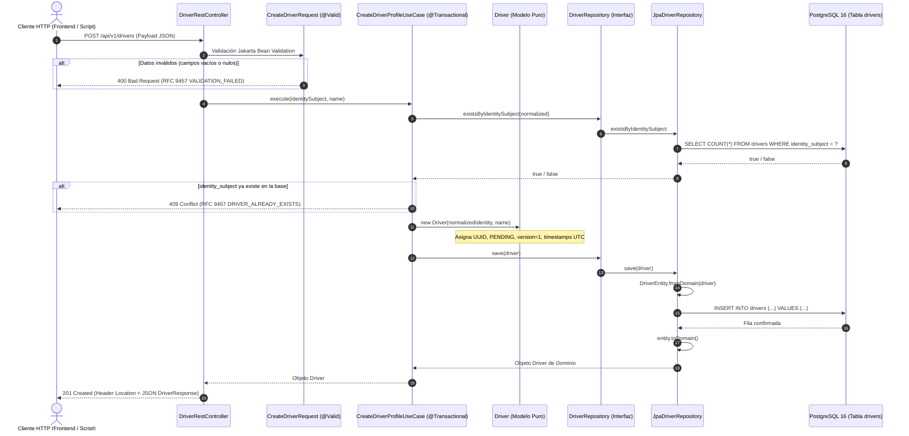

# Guía Explicativa y de Defensa: HU-01 — Crear Perfil de Conductor

**Microservicio M3: Conductores y Vehículos**  
**Cátedra:** Desarrollo de Software 2026 — UTN Facultad Regional Resistencia  
**Audiencia:** Alumnos, docentes y evaluadores técnicos  
**Propósito:** Comprender los fundamentos conceptuales, el diseño arquitectónico y el código implementado para dominar la defensa oral del proyecto.

---

## 1. Glosario Inicial y Analogías Simples

Para defender este proyecto ante la cátedra no alcanza con memorizar nombres de librerías; es fundamental comprender **por qué cada pieza está donde está**. A continuación, explicamos los conceptos clave mediante una analogía cotidiana y definiciones directas.

### 1.1 La Analogía Central: "La Mesa de Entradas del Registro de Conductores"

Imaginemos una oficina pública física encargada de registrar conductores en una ciudad:

```
[ Ciudadano con un Papel ] 
         │
         ▼
[ Ventanilla de Recepción ]  ──► (Verifica que el papel tenga nombre y no esté roto)
         │
         ▼
[ Funcionario / Inspector ]  ──► (Aplica la ley: "¿Ya está registrado?", "Arma el expediente")
         │
         ▼
[ Archivista Central ]       ──► (Traduce el expediente a los casilleros del mueble metálico)
         │
         ▼
[ Bóveda de Archivos ]       ──► (Estantería física blindada e incombustible)
```

1. **El Ciudadano / Solicitante (Cliente HTTP / Postman / Frontend):** Llega a la puerta con la intención de darse de alta.
2. **La Ventanilla de Recepción (`DriverRestController`):** Atiende al ciudadano. No juzga si la persona sabe manejar o si es apta para conducir; solo se fija en que el papel que le entregaron no esté en blanco, tenga el formato esperado y los casilleros requeridos completos.
3. **El Formulario Provisorio de Trámite (`CreateDriverRequest` - DTO):** Es la hoja borrador que completó el ciudadano en la fila. Es descartable: solo sirve para transportar los datos desde la calle hasta la ventanilla.
4. **El Funcionario / Inspector de Trámites (`CreateDriverProfileUseCase`):** Es quien conoce las leyes de la institución. Recibe los datos validados de la ventanilla, consulta al archivo general para verificar si esta persona ya tiene legajo abierto, y si no existe, autoriza la apertura del expediente.
5. **El Expediente / Legajo Oficial (`Driver.java` - Entidad de Dominio):** Es el documento oficial timbrado. Nace con un número de expediente irrepetible (`UUID`), en estado `PENDING` (pendiente, porque aún no rindió exámenes ni presentó vehículo), en su versión original `1`, y con la fecha y hora exacta de apertura. Contiene reglas de oro inviolables: nadie puede nacer sin nombre ni aprobado por arte de magia.
6. **El Contrato del Archivista (`DriverRepository` - Puerto):** Es la lista de pedidos que el funcionario le puede hacer al archivo ("Buscame el legajo con este número", "Guardame este legajo"). El funcionario no sabe ni le importa de qué marca son los archivadores ni cómo están ordenadas las carpetas; él solo se comunica a través del contrato.
7. **El Archivista Informático (`JpaDriverRepository` y `DriverEntity` - Adaptador Secundario):** Toma el expediente oficial y lo transcribe a las fichas indexadas que entran perfectamente en las ranuras de los muebles de la bóveda.
8. **La Bóveda Blindada (PostgreSQL 16):** La base de datos donde las fichas quedan protegidas de forma permanente contra incendios, cortes de luz y pérdidas de información.

---

### 1.2 Términos Clave Explicados en Lenguaje Coloquial

| Concepto Técnico | ¿Qué es en lenguaje simple? | ¿Para qué sirve en nuestro proyecto? |
| :--- | :--- | :--- |
| **Arquitectura Hexagonal (Puertos y Adaptadores)** | Es la práctica de construir el corazón de la aplicación (reglas de negocio) completamente aislado del exterior (bases de datos, controladores web, frameworks). | Si mañana decidimos cambiar PostgreSQL por Oracle o Spring por Quarkus, o reemplazar la API REST por eventos Kafka, **el código del negocio no se modifica en lo más mínimo**. |
| **Puertos (Ports)** | Son interfaces Java puras que definen contratos de lo que el negocio necesita hacer con el exterior. | `DriverRepository` le dice a la aplicación: *"Necesito poder guardar un conductor y buscar si existe por su identidad federada"*, sin importar cómo se guarde. |
| **Adaptadores (Adapters)** | Son las clases que implementan los puertos para una tecnología específica. | `DriverRestController` adapta peticiones HTTP JSON para llamar al caso de uso. `JpaDriverRepository` adapta llamadas Java a queries SQL de PostgreSQL mediante Spring Data JPA. |
| **DTO (Data Transfer Object)** | Son objetos mensajeros tontos cuyo único objetivo es transportar datos entre capas o por la red, sin lógica de negocio. | `CreateDriverRequest` recibe el JSON de entrada con validaciones de formato (`@NotBlank`). `DriverResponse` envía la respuesta limpia y estructurada al cliente. |
| **Entidad de Dominio** | Es la clase que modela el concepto central del negocio y protege sus reglas. | `Driver.java` es un objeto Java puro que encapsula los datos del conductor y garantiza que nazca en estado coherente. |
| **Invariantes** | Son condiciones que deben cumplirse **siempre** para que un objeto sea válido; nunca pueden violarse. | Un conductor **no puede** tener nombre vacío, **no puede** carecer de `identity_subject`, y al crearse **siempre** debe iniciar en estado `PENDING` y versión `1`. |
| **Persistencia** | La capacidad de guardar los datos de un objeto de forma duradera en un medio no volátil (disco). | Que los conductores sigan existiendo en PostgreSQL incluso si se reinicia el servidor o se cae el contenedor Docker. |
| **Transaccionalidad (`@Transactional`)** | Principio de "todo o nada" (propiedad Atómica de ACID). Si algo falla en el medio del proceso, nada de lo que se intentó guardar queda grabado (Rollback automático). | Garantiza que nunca quede un registro a medio guardar o en estado inconsistente ante una excepción no controlada. |
| **UUID (Universally Unique Identifier)** | Un identificador numérico de 128 bits expresado como texto hexadecimal de 36 caracteres (ej. `81045426-848e-43bc-9b6d-a223135e45be`). | A diferencia de los IDs autoincrementales (`1, 2, 3...`), se puede generar en la aplicación sin consultar a la base de datos, es globalmente único y no revela información secuencial ni volúmenes de negocio a atacantes. |
| **Flyway** | Un sistema de "control de versiones" para la base de datos (Database-as-Code). | En lugar de ejecutar scripts manuales con phpMyAdmin o DBeaver, Flyway aplica automáticamente los archivos `.sql` (`V1__...`) al arrancar la aplicación, garantizando que todos los integrantes del equipo tengan exactamente la misma estructura de tablas. |
| **RFC 9457 (Problem Details)** | Estándar internacional del IETF para reportar errores en APIs HTTP en formato JSON uniforme. | En vez de responder con un texto plano o estructuras arbitrarias, todos los errores (400, 409, 500) devuelven un JSON estándar con `type`, `title`, `status`, `detail` y `correlationId`. |

---

## 2. Stack Tecnológico y Justificación ("¿Por qué estas herramientas?")

Ante una pregunta de la cátedra del estilo: *"¿Por qué eligieron esta tecnología en lugar de otra?"*, estas son las respuestas y justificaciones técnicas fundamentadas:

```
┌─────────────────────────────────────────────────────────────┐
│                       STACK M3                              │
├───────────────┬─────────────────────────────┬───────────────┤
│ Lenguaje:     │ Java 21 (LTS)               │ Enterprise    │
│ Framework:    │ Spring Boot 3.3.4           │ IoC & MVC     │
│ Persistencia: │ PostgreSQL 16 + Flyway      │ ACID & Migr.  │
│ Entorno:      │ Docker Compose              │ Aislamiento   │
│ Construcción: │ Maven 3.9+ (con Wrapper)    │ Determinismo  │
└───────────────┴─────────────────────────────┴───────────────┘
```

### 2.1 Java 21 (Long-Term Support)
* **¿Por qué no Java 8 u 11?** Java 21 es la versión de soporte extendido más moderna. Incorpora características de lenguaje de última generación:
  * **Records (`record`):** Utilizados para DTOs inmutables como `DriverResponse` y comandos de aplicación (`CreateDriverCommand`). Eliminan cientos de líneas de código repetitivo (getters, `equals`, `hashCode`, `toString`) garantizando inmutabilidad estricta por diseño.
  * **Virtual Threads (Project Loom):** Permite procesar miles de peticiones concurrentes de I/O bloqueante (llamadas a base de datos y endpoints HTTP) sin saturar los hilos del sistema operativo y con mínimo consumo de memoria.
  * **Pattern Matching y Switch mejorado:** Mayor expresividad y seguridad estática de tipos.
  * **Tipado Fuerte y Seguridad en Tiempo de Compilación:** A diferencia de lenguajes dinámicos (Node.js/Python), el compilador detecta inconsistencias antes de la ejecución, minimizando fallos en producción.

### 2.2 Spring Boot 3.3.x
* **¿Por qué Spring Boot?** Es el marco de trabajo líder en la industria enterprise para aplicaciones Java.
  * **Inyección de Dependencias e Inversión de Control (IoC):** Facilita el desacoplamiento exigido por la Arquitectura Hexagonal. Conecta puertos (`DriverRepository`) con sus implementaciones (`JpaDriverRepository`) sin crear dependencias circulares ni código pegamento manual.
  * **No reinventar la rueda:** Provee módulos de nivel de producción listos para usar: validación declarativa con Jakarta Bean Validation (`spring-boot-starter-validation`), ORM con Spring Data JPA (`spring-boot-starter-data-jpa`) y servidor web embebido Tomcat.
  * **Soporte Nativo de RFC 9457:** A partir de Spring 6 / Boot 3, la clase `ProblemDetail` viene integrada de manera nativa, facilitando el cumplimiento de los estándares de error de la cátedra.

### 2.3 PostgreSQL 16
* **¿Por qué PostgreSQL y no una base NoSQL como MongoDB?**
  * **Cumplimiento ACID Estricto:** La información de conductores, habilitaciones y auditorías requiere consistencia inmediata, no eventual. Un conductor no puede quedar en un estado ambiguo.
  * **Soporte Nativo y Optimizado para UUID:** PostgreSQL almacena UUIDs en un tipo nativo de 16 bytes binarios optimizados para índices B-Tree, a diferencia de otros motores que los almacenan como cadenas de texto (`VARCHAR(36)`), ahorrando espacio y acelerando las búsquedas.
  * **Integridad a Nivel Motor:** Las restricciones `UNIQUE` (en `identity_subject`) y las reglas `CHECK` (en `qualification_status`) garantizan que la base de datos rechace datos corruptos incluso si ocurriera un fallo en la capa de software.

### 2.4 Docker Compose
* **¿Por qué Docker Compose para la base de datos?**
  * **Reproducibilidad Inmediata ("En mi máquina sí funciona" se erradica):** Ningún integrante del grupo de desarrollo ni el docente evaluador necesita instalar PostgreSQL manualmente en Windows, configurar usuarios de sistema ni lidiar con servicios locales en conflicto.
  * **Aislamiento y Limpieza:** El motor corre en un contenedor aislado con su puerto mapeado (`5432:5432`). Los datos persisten de manera controlada en el volumen Docker `pgdata_m3`.
  * **Portabilidad:** Se levanta con una sola línea de comando (`docker compose up -d postgres`) en Windows, Linux o macOS.

### 2.5 Flyway
* **¿Por qué Flyway y no `hibernate.ddl-auto: update`?**
  * **Peligro de `ddl-auto: update`:** En entornos reales o de entrega, dejar que Hibernate altere las tablas automáticamente es una pésima práctica porque puede borrar columnas, generar bloqueos o producir esquemas impredecibles entre distintas computadoras.
  * **Trazabilidad y Versionado Histórico (Database-as-Code):** Cada cambio en la base de datos se escribe como un archivo de migración SQL inmutable y versionado (`V1__create_drivers_table.sql`).
  * **Ejecución Automática:** Al arrancar la aplicación, Flyway detecta si hay migraciones pendientes, las ejecuta en orden cronológico y registra el estado en la tabla interna `flyway_schema_history`.

### 2.6 Maven (con Maven Wrapper `mvnw`)
* **¿Por qué Maven?**
  * **Gestión Determinística de Dependencias:** El archivo `pom.xml` fija con exactitud las versiones de cada biblioteca, evitando sorpresas causadas por descargas automáticas de versiones incompatibles.
  * **Ciclo de Vida Estandarizado:** Provee fases estándar de la industria (`compile`, `test`, `package`).
  * **Maven Wrapper (`mvnw` / `mvnw.cmd`):** Permite compilar y correr la aplicación sin exigir que la máquina host tenga Maven instalado globalmente en sus variables de entorno; el wrapper se encarga de descargar y usar la versión exacta requerida.

---

## 3. ¿Qué hace la HU-01 y cómo funciona el código paso a paso?

### 3.1 Propósito Funcional de la HU-01
La historia **HU-01 (Crear perfil de conductor)** representa el **registro inicial** de un chofer en la plataforma:
1. Recibe la identidad federada (`identitySubject`, el identificador único que entrega el proveedor de autenticación de M1 como Auth0 o Keycloak) y el nombre completo del conductor.
2. Comprueba que esa identidad no haya sido registrada previamente.
3. Genera un nuevo perfil con un identificador global `UUID`.
4. Establece su estado de habilitación inicial como **`PENDING`** (Pendiente), ya que un conductor recién registrado aún no ha subido documentación, no tiene vehículo aprobado ni cuenta con validación de aptitud.
5. Inicia el control de auditoría y concurrencia optimista en **`version = 1`** con marcas de tiempo en UTC (`Instant.now()`).
6. Retorna la respuesta HTTP **`201 Created`** con la cabecera `Location: /api/v1/drivers/{id}` y el cuerpo del conductor creado.

---

### 3.2 Diagrama Secuencial del Circuito Completo



---

### 3.3 El Circuito Real Explicado en 10 Pasos

1. **Recepción HTTP:** El cliente realiza una petición `POST` al endpoint `/api/v1/drivers` con el cuerpo en formato JSON (`{"identitySubject": "...", "name": "..."}`).
2. **Deserialización y Mapeo a DTO:** Jackson convierte el JSON en una instancia de [CreateDriverRequest.java](file:///c:/Users/ULISES/Desktop/Dds%20M3/src/main/java/ar/edu/utn/frre/m3/adapter/rest/CreateDriverRequest.java). Gracias a `@JsonAlias({"identity_subject", "subject"})`, acepta indistintamente convenciones `camelCase` o `snake_case`.
3. **Validación Sintáctica Declarativa:** El framework ejecuta `@Valid`. Se comprueba que `identitySubject` y `name` cumplan con `@NotBlank` y los límites de tamaño `@Size`. Si algún dato es inválido, Spring interrumpe el flujo y [GlobalExceptionHandler.java](file:///c:/Users/ULISES/Desktop/Dds%20M3/src/main/java/ar/edu/utn/frre/m3/adapter/rest/GlobalExceptionHandler.java) produce una respuesta `400 Bad Request` en formato RFC 9457 con la lista de campos fallidos (`invalidFields`), sin tocar la lógica de negocio ni la base de datos.
4. **Despacho al Caso de Uso:** [DriverRestController.java](file:///c:/Users/ULISES/Desktop/Dds%20M3/src/main/java/ar/edu/utn/frre/m3/adapter/rest/DriverRestController.java) delega la ejecución al servicio de aplicación [CreateDriverProfileUseCase.java](file:///c:/Users/ULISES/Desktop/Dds%20M3/src/main/java/ar/edu/utn/frre/m3/application/usecase/CreateDriverProfileUseCase.java).
5. **Inicio de Transacción y Normalización:** El método está protegido con `@Transactional`. Se normalizan las entradas (remoción de espacios en blanco mediante `.trim()`).
6. **Validación Semántica de Unicidad:** El caso de uso consulta al puerto [DriverRepository.java](file:///c:/Users/ULISES/Desktop/Dds%20M3/src/main/java/ar/edu/utn/frre/m3/application/port/DriverRepository.java) mediante `existsByIdentitySubject(normalized)`. Si ya existe un conductor con esa identidad, se lanza la excepción de negocio `DriverAlreadyExistsException`, que el manejador global intercepta y traduce a un `409 Conflict` (RFC 9457).
7. **Construcción de la Entidad de Dominio:** Al confirmar que la identidad está libre, se invoca `new Driver(normalizedIdentity, name)`. La entidad [Driver.java](file:///c:/Users/ULISES/Desktop/Dds%20M3/src/main/java/ar/edu/utn/frre/m3/domain/Driver.java) genera un `UUID.randomUUID()`, asigna el estado `QualificationStatus.PENDING`, inicializa el contador de versión en `1` y registra las marcas de tiempo actuales en UTC (`Instant.now()`).
8. **Transformación a Entidad Relacional (Persistencia):** El caso de uso llama a `driverRepository.save(newDriver)`. El adaptador [JpaDriverRepository.java](file:///c:/Users/ULISES/Desktop/Dds%20M3/src/main/java/ar/edu/utn/frre/m3/adapter/persistence/JpaDriverRepository.java) toma el objeto de dominio y llama a `DriverEntity.fromDomain(driver)`, convirtiéndolo a [DriverEntity.java](file:///c:/Users/ULISES/Desktop/Dds%20M3/src/main/java/ar/edu/utn/frre/m3/adapter/persistence/DriverEntity.java) (anotada con `@Entity` y `@Table(name = "drivers")`).
9. **Inserción SQL en PostgreSQL:** [SpringDataDriverRepository.java](file:///c:/Users/ULISES/Desktop/Dds%20M3/src/main/java/ar/edu/utn/frre/m3/adapter/persistence/SpringDataDriverRepository.java) ejecuta la sentencia `INSERT INTO drivers ...` mediante Hibernate. PostgreSQL valida sus restricciones `UNIQUE` y `CHECK`. Al completarse con éxito, la transacción confirma el registro y el adaptador reconstituye el objeto de negocio mediante `savedEntity.toDomain()`.
10. **Construcción de Respuesta HTTP:** El controlador recibe el `Driver`, genera la cabecera `Location: /api/v1/drivers/{id}`, mapea los datos a un Java Record [DriverResponse.java](file:///c:/Users/ULISES/Desktop/Dds%20M3/src/main/java/ar/edu/utn/frre/m3/adapter/rest/DriverResponse.java) y devuelve `201 Created`.

---

### 3.4 Rol Detallado de Cada Componente del Código

#### 1. `DriverRestController.java` (Adaptador Primario / Conducción)
* **Ubicación:** `src/main/java/ar/edu/utn/frre/m3/adapter/rest/DriverRestController.java`
* **Responsabilidad:** Es la puerta de entrada HTTP.
  * Expone el endpoint `POST /api/v1/drivers`.
  * Recibe el cuerpo JSON y aplica validación automática con `@Valid @RequestBody CreateDriverRequest request`.
  * Invoca al caso de uso y no contiene reglas de negocio.
  * Sigue las buenas prácticas REST: responde con código `201 Created`, incluye el header `Location` apuntando a la URI del recurso recién creado (`/api/v1/drivers/{id}`) y devuelve el cuerpo representativo.

#### 2. `CreateDriverRequest.java` (DTO de Entrada)
* **Ubicación:** `src/main/java/ar/edu/utn/frre/m3/adapter/rest/CreateDriverRequest.java`
* **Responsabilidad:** Validación perimetral sintáctica de datos entrantes.
  * Usa anotaciones de Jakarta Bean Validation:
    * `@NotBlank(message = "El identity_subject es obligatorio")`
    * `@Size(max = 255)`
    * `@NotBlank(message = "El nombre es obligatorio")`
    * `@Size(min = 2, max = 255)`
  * Soporta interoperabilidad mediante `@JsonAlias({"identity_subject", "subject"})` y `@JsonAlias({"fullName", "full_name", "nombre"})`, permitiendo integrarse sin fricción con clientes que envíen `snake_case` o `camelCase`.

#### 3. `CreateDriverProfileUseCase.java` (Capa de Aplicación / Orquestador)
* **Ubicación:** `src/main/java/ar/edu/utn/frre/m3/application/usecase/CreateDriverProfileUseCase.java`
* **Responsabilidad:** Orquestar el flujo del negocio.
  * Posee la anotación `@Transactional`: garantiza atomicidad y aislamiento en las operaciones sobre la base de datos.
  * Aplica sanitización de cadenas (trimming).
  * Ejecuta la verificación de duplicados usando el puerto `DriverRepository`.
  * Si la identidad ya existe, interrumpe el flujo arrojando `DriverAlreadyExistsException`.
  * Si está disponible, crea la entidad de dominio y solicita su persistencia.
  * También provee una sobrecarga con el record desacoplado `CreateDriverCommand`.

#### 4. `Driver.java` (Entidad Raíz de Dominio Puro)
* **Ubicación:** `src/main/java/ar/edu/utn/frre/m3/domain/Driver.java`
* **Responsabilidad:** El corazón del negocio.
  * **Cero dependencias:** No tiene anotaciones de Spring, JPA, Hibernate ni Jackson. Es código Java estándar.
  * **Protege sus invariantes:** Su constructor principal no permite nombres ni `identitySubject` vacíos o nulos; asigna de forma determinística el estado `QualificationStatus.PENDING`, fija la versión en `1` y genera su `UUID`.
  * Provee un segundo constructor para que la capa de persistencia pueda reconstituir la entidad existente sin alterar sus valores históricos.
  * Expone métodos de comportamiento semántico (`updateName`, `changeQualificationStatus`, `incrementVersion`) que actualizan automáticamente `updatedAt`.

#### 5. `DriverRepository.java` (Puerto de Persistencia)
* **Ubicación:** `src/main/java/ar/edu/utn/frre/m3/application/port/DriverRepository.java`
* **Responsabilidad:** Contrato que define qué operaciones de persistencia necesita el dominio.
  * Es una interfaz pura de Java.
  * Declara métodos como `existsByIdentitySubject(String identitySubject)`, `findByIdentitySubject(...)`, `findById(UUID id)` y `save(Driver driver)`.
  * No expone ninguna clase de Spring Data ni detalles de SQL.

#### 6. `DriverEntity.java` (Entidad JPA de Infraestructura)
* **Ubicación:** `src/main/java/ar/edu/utn/frre/m3/adapter/persistence/DriverEntity.java`
* **Responsabilidad:** Representación relacional de la tabla `drivers`.
  * Contiene las anotaciones de Hibernate/JPA: `@Entity`, `@Table(name = "drivers")`, `@Id`, `@Column(name = "identity_subject", unique = true)`, `@Enumerated(EnumType.STRING)`.
  * **Mappers bidireccionales:**
    * `DriverEntity.fromDomain(Driver driver)`: convierte el objeto puro del negocio en entidad relacional.
    * `entity.toDomain()`: reconstituye la entidad pura del negocio a partir de los datos leídos de la tabla.
  * Aísla las particularidades de Hibernate (como constructores sin argumentos requeridos por JPA) para que no ensucien la clase de dominio `Driver.java`.

#### 7. `JpaDriverRepository.java` (Adaptador Secundario de Salida)
* **Ubicación:** `src/main/java/ar/edu/utn/frre/m3/adapter/persistence/JpaDriverRepository.java`
* **Responsabilidad:** Implementa el puerto `DriverRepository`.
  * Recibe las llamadas del caso de uso, las delega a `SpringDataDriverRepository` (que hereda de `JpaRepository<DriverEntity, UUID>`), y utiliza los mappers para asegurar que hacia adentro y hacia afuera solo circulen entidades puras de dominio `Driver`.

#### 8. `GlobalExceptionHandler.java` (Manejador Global de Errores — RFC 9457)
* **Ubicación:** `src/main/java/ar/edu/utn/frre/m3/adapter/rest/GlobalExceptionHandler.java`
* **Responsabilidad:** Traducir excepciones técnicas y de negocio a respuestas HTTP uniformes bajo el estándar RFC 9457 (`ProblemDetail`):
  * `DriverAlreadyExistsException` $\rightarrow$ `409 Conflict` (`code: "DRIVER_ALREADY_EXISTS"`).
  * `MethodArgumentNotValidException` $\rightarrow$ `400 Bad Request` (`code: "VALIDATION_FAILED"`, con el mapa de errores en `invalidFields`).
  * `IllegalArgumentException` $\rightarrow$ `400 Bad Request` (`code: "INVALID_ARGUMENT"`).
  * Genera un identificador de seguimiento `correlationId` en cada respuesta para facilitar la auditoría en logs.

---

## 4. Comunicación Entre Componentes y Visión Sistémica

### 4.1 Comunicación Interna (Dentro del Microservicio M3)

La historia **HU-01 no es un componente aislado; es la piedra fundamental de toda la arquitectura de M3**:

```
                       ┌────────────────────────┐
                       │  HU-01: CREAR CONDUCTOR │
                       │   id: UUID (Clave PK)   │
                       │   status: PENDING       │
                       └───────────┬────────────┘
                                   │
         ┌─────────────────────────┼─────────────────────────┐
         ▼                         ▼                         ▼
┌──────────────────┐     ┌──────────────────┐     ┌──────────────────┐
│ HU-03 / HU-04    │     │ HU-05 a HU-08    │     │ HU-09 / HU-10    │
│ Registro y       │     │ Habilitación     │     │ Aptitud y        │
│ Vinculación de   │     │ Documental       │     │ Elegibilidad     │
│ Vehículos        │     │ (Licencia, VTV,  │     │ Operativa        │
│ (FK: driver_id)  │     │ Seguro del chofer│     │ (Transición de   │
│                  │     │ y del auto)      │     │ PENDING a        │
│                  │     │                  │     │ APPROVED)        │
└──────────────────┘     └──────────────────┘     └──────────────────┘
```

1. **Vínculo con Vehículos (HU-03 y HU-04):**
   * Un vehículo no puede asociarse a la nada. La relación entre conductores y vehículos requiere el `id` (UUID) generado en HU-01 como clave foránea lógica de pertenencia o asignación.
2. **Vínculo con Documentación (HU-05 a HU-08):**
   * Toda la documentación (licencia de conducir, seguro automotor, verificación técnica) se carga **contra el legajo de un conductor existente**. Sin el perfil creado en HU-01, no existe entidad a la cual auditar vencimientos ni validar certificados.
3. **Vínculo con Aptitud y Estado Operativo (HU-09 y HU-10):**
   * El estado `PENDING` fijado en HU-01 es el estado génesis de la máquina de estados del conductor:
     $$\text{PENDING} \xrightarrow{\text{Docs + Revisión aprobadas}} \text{APPROVED}$$
     $$\text{APPROVED} \xrightarrow{\text{Sanción / Incumplimiento}} \text{SUSPENDED} \text{ / } \text{REJECTED}$$
   * HU-01 asegura que ningún conductor empiece habilitado para circular antes de que el proceso documental formal lo apruebe.
4. **Concurrencia Optimista (`version = 1`):**
   * En las siguientes historias, cuando varios procesos intenten actualizar el perfil en simultáneo (por ejemplo, aprobación documental y asignación de vehículo concurrentes), el campo `version` evitará sobreescrituras ciegas (*Lost Updates*).

---

### 4.2 Comunicación Externa (Con Otros Microservicios)

En la arquitectura distribuida del Trabajo Práctico Integrador, M3 interactúa con los demás microservicios mediante contratos acordados:

```
               ┌──────────────────────────────┐
               │    M1: Identidad y Auth      │
               │ (Emite JWT con Subject/UUID) │
               └──────────────┬───────────────┘
                              │
               identity_subject (Claims del Token)
                              │
                              ▼
┌─────────────────────────────────────────────────────────────┐
│              M3: Conductores y Vehículos                    │
│                                                             │
│   HU-01: Asocia identity_subject ──► Driver (id: UUID)      │
│   Estado del Chofer: PENDING / APPROVED / SUSPENDED         │
└──────────────┬──────────────────────────────┬───────────────┘
               │                              │
        ¿Está habilitado?             ¿Quién es el chofer?
               │                              │
               ▼                              ▼
┌──────────────────────────────┐ ┌──────────────────────────────┐
│       M4: Despacho           │ │     M6: Calificaciones       │
│  (Asignación de viajes solo  │ │  (Registra puntajes de       │
│   a choferes APPROVED)       │ │   pasajeros sobre driver_id) │
└──────────────────────────────┘ └──────────────────────────────┘
```

* **Relación con M1 (Identidad / Autenticación):**
  * M3 **no maneja contraseñas, emails ni credenciales**. La responsabilidad de autenticar al usuario recae enteramente en M1.
  * M1 emite un token de identidad cuyo identificador principal es el claim `sub` (ej. `auth0|6600abcd1234` o el UUID de M1).
  * En HU-01, este valor se guarda en la columna `identity_subject` con restricción de unicidad (`UNIQUE`). Es el **puente de federación de identidad** entre el usuario autenticado en M1 y su legajo operativo en M3.
* **Relación con M4 (Despacho y Asignación de Viajes):**
  * Cuando un pasajero solicita un viaje en M4, este consulta a M3: *"¿El conductor X está habilitado para recibir viajes?"*.
  * Si el conductor recién fue creado con HU-01, su estado es `PENDING`, por lo que M3 le responde a M4 que **no es elegible**, evitando que choferes sin papeles tomen pasajeros.
* **Relación con M6 (Calificaciones y Reputación):**
  * Cuando finaliza un viaje, las valoraciones de los pasajeros se registran contra el `driver_id` (UUID) generado originariamente por la HU-01 de M3.

---

## 5. Guía Práctica de Verificación y Pruebas

Esta sección contiene los comandos exactos para reproducir las pruebas en el entorno local de desarrollo y verificar que toda la suite esté en verde.

### 5.1 Paso 1: Levantar PostgreSQL con Docker Compose

Asegurate de tener Docker Desktop abierto y en ejecución. Luego, ejecutá en una terminal de PowerShell:

```powershell
# 1. Levantar el contenedor de PostgreSQL en segundo plano
docker compose up -d postgres

# 2. Verificar que el contenedor esté corriendo
docker compose ps
```

*Salida esperada de `docker compose ps`:*
```text
NAME          IMAGE                COMMAND                  SERVICE    CREATED         STATUS         PORTS
m3-postgres   postgres:16-alpine   "docker-entrypoint.s…"   postgres   5 minutes ago   Up 5 minutes   0.0.0.0:5432->5432/tcp
```

### 5.2 Paso 2: Ejecutar la Suite de Pruebas Automatizadas

Antes de iniciar la aplicación, verificamos que todos los tests unitarios, de controlador y de integración pasen exitosamente:

```powershell
# En Windows:
.\mvnw.cmd test

# En Linux o macOS:
./mvnw test
```

*Salida esperada al finalizar:*
```text
[INFO] Tests run: 9, Failures: 0, Errors: 0, Skipped: 0
[INFO] BUILD SUCCESS
```

---

### 5.3 Paso 3: Iniciar la Aplicación Spring Boot

```powershell
# Iniciar el microservicio en el puerto 3003
.\mvnw.cmd spring-boot:run
```

Al iniciar, en la consola se observará cómo Flyway aplica la migración:
```text
o.f.c.i.database.base.DatabaseType       : Database: PostgreSQL 16.x
o.f.core.internal.command.DbMigrate      : Current version of schema "public": << Empty Schema >>
o.f.core.internal.command.DbMigrate      : Migrating schema "public" to version "1 - create drivers table"
o.f.core.internal.command.DbMigrate      : Successfully applied 1 migration to schema "public"
Tomcat started on port 3003 (http) with context path '/'
```

---

### 5.4 Paso 4: Pruebas Manuales con PowerShell y cURL

Abrí una **segunda ventana de PowerShell** para ejecutar las peticiones HTTP contra la API activa en `http://localhost:3003`:

#### Caso de Prueba 1: Creación Exitosa (`201 Created`)

**Comando en PowerShell (`Invoke-RestMethod`):**
```powershell
$body = @{
    identitySubject = "auth0|juan-perez-12345"
    name            = "Juan Perez"
} | ConvertTo-Json

Invoke-RestMethod -Uri "http://localhost:3003/api/v1/drivers" `
                  -Method Post `
                  -ContentType "application/json" `
                  -Body $body
```

**Comando en cURL:**
```bash
curl -i -X POST "http://localhost:3003/api/v1/drivers" \
     -H "Content-Type: application/json" \
     -d '{"identitySubject":"auth0|juan-perez-12345","name":"Juan Perez"}'
```

**Respuesta HTTP Esperada (`201 Created`):**
```http
HTTP/1.1 201 Created
Location: /api/v1/drivers/81045426-848e-43bc-9b6d-a223135e45be
Content-Type: application/json
```
```json
{
  "id": "81045426-848e-43bc-9b6d-a223135e45be",
  "identitySubject": "auth0|juan-perez-12345",
  "name": "Juan Perez",
  "qualificationStatus": "PENDING",
  "version": 1,
  "createdAt": "2026-10-10T17:19:20.642892700Z",
  "updatedAt": "2026-10-10T17:19:20.642892700Z"
}
```

> **Aspectos a destacar en la defensa:**
> 1. El código de respuesta es `201 Created`, no un genérico `200 OK`.
> 2. Se envía la cabecera `Location` con la URI canónica del nuevo recurso.
> 3. El estado inicial es obligatoriamente `PENDING` y la versión de auditoría es `1`.

---

#### Caso de Prueba 2: Rechazo por Intento Duplicado (`409 Conflict`)

Si volvemos a enviar exactamente la misma petición con el mismo `identitySubject`:

**Comando en PowerShell (con captura de error):**
```powershell
$body = @{
    identitySubject = "auth0|juan-perez-12345"
    name            = "Juan Perez"
} | ConvertTo-Json

try {
    Invoke-RestMethod -Uri "http://localhost:3003/api/v1/drivers" `
                      -Method Post `
                      -ContentType "application/json" `
                      -Body $body
} catch {
    $stream = $_.Exception.Response.GetResponseStream()
    (New-Object System.IO.StreamReader($stream)).ReadToEnd()
}
```

**Comando en cURL:**
```bash
curl -i -X POST "http://localhost:3003/api/v1/drivers" \
     -H "Content-Type: application/json" \
     -d '{"identitySubject":"auth0|juan-perez-12345","name":"Juan Perez"}'
```

**Respuesta HTTP Esperada (`409 Conflict` — RFC 9457):**
```http
HTTP/1.1 409 Conflict
Content-Type: application/problem+json
```
```json
{
  "type": "https://utn.edu.ar/errors/driver-already-exists",
  "title": "Conflicto de identidad de conductor",
  "status": 409,
  "detail": "Ya existe un conductor registrado con el identity_subject: auth0|juan-perez-12345",
  "code": "DRIVER_ALREADY_EXISTS",
  "identitySubject": "auth0|juan-perez-12345",
  "correlationId": "806a6c4b-bce9-40ad-be00-dc08bbddb452"
}
```

> **Aspectos a destacar en la defensa:**
> 1. El código es `409 Conflict`, reflejando un conflicto de estado en la base de datos.
> 2. El `Content-Type` es `application/problem+json` respetando el estándar RFC 9457.
> 3. Contiene un `correlationId` para trazar el error en los logs del servidor.

---

#### Caso de Prueba 3: Rechazo por Datos Vacíos o Inválidos (`400 Bad Request`)

Si se envían campos en blanco o nulos:

**Comando en PowerShell:**
```powershell
$invalidBody = @{
    identitySubject = ""
    name            = ""
} | ConvertTo-Json

try {
    Invoke-RestMethod -Uri "http://localhost:3003/api/v1/drivers" `
                      -Method Post `
                      -ContentType "application/json" `
                      -Body $invalidBody
} catch {
    $stream = $_.Exception.Response.GetResponseStream()
    (New-Object System.IO.StreamReader($stream)).ReadToEnd()
}
```

**Comando en cURL:**
```bash
curl -i -X POST "http://localhost:3003/api/v1/drivers" \
     -H "Content-Type: application/json" \
     -d '{"identitySubject":"","name":""}'
```

**Respuesta HTTP Esperada (`400 Bad Request` — RFC 9457):**
```http
HTTP/1.1 400 Bad Request
Content-Type: application/problem+json
```
```json
{
  "type": "https://utn.edu.ar/errors/validation-error",
  "title": "Error de validación en la solicitud",
  "status": 400,
  "detail": "La solicitud contiene datos inválidos o incompletos",
  "code": "VALIDATION_FAILED",
  "correlationId": "692c55fa-b649-43c2-abcf-4ca664724c08",
  "invalidFields": {
    "identitySubject": "El identity_subject es obligatorio",
    "name": "El nombre debe tener entre 2 y 255 caracteres"
  }
}
```

> **Aspectos a destacar en la defensa:**
> 1. Código HTTP `400 Bad Request`.
> 2. El objeto `invalidFields` especifica de manera precisa qué campos fallaron y por qué razón, facilitando la corrección en el frontend.

---

### 5.5 Cobertura y Estructura de las Pruebas Automatizadas

El proyecto implementa la pirámide de pruebas recomendada por las buenas prácticas de ingeniería de software:

```
           / \
          /   \     E2E / Integración (DriverIntegrationTest)
         /-----\    Controlador / Slicing (DriverRestControllerTest)
        /       \   Unitarios Puros (CreateDriverProfileUseCaseTest)
       /_________\
```

1. **Pruebas Unitarias de Aplicación (`CreateDriverProfileUseCaseTest.java`):**
   * Corren con Mockito en memoria (`@ExtendWith(MockitoExtension.class)`).
   * Tardan apenas milisegundos en ejecutarse.
   * Validan la lógica del caso de uso simulando el repositorio mediante mocks: creación exitosa con estado `PENDING` y versión 1, disparo de excepción ante duplicados y rechazo de parámetros nulos/vacíos.
2. **Pruebas de Slicing Web (`DriverRestControllerTest.java`):**
   * Corren con `@WebMvcTest(controllers = DriverRestController.class)`.
   * Prueban exclusivamente la capa HTTP sin levantar la base de datos ni los servicios reales.
   * Validan la serialización/deserialización JSON, las anotaciones de validación `@Valid`, el retorno de códigos HTTP 201, 400 y 409 y la presencia de la cabecera `Location`.
3. **Pruebas de Integración End-to-End (`DriverIntegrationTest.java`):**
   * Corren con el contexto completo de Spring Boot (`@SpringBootTest(webEnvironment = RANDOM_PORT)`).
   * Se conectan a PostgreSQL real y ejecutan las migraciones de Flyway.
   * Envían peticiones HTTP mediante `MockMvc`, verifican la respuesta y además consultan directamente la base de datos con `driverRepository.existsByIdentitySubject(...)` para comprobar que la fila se haya grabado efectivamente en disco.
   * Implementan un método de limpieza con `@AfterEach` que elimina los registros generados en cada test para asegurar total idempotencia e independencia en ejecuciones continuas.

---

## 6. Preguntas Frecuentes y Guía de Defensa ante la Cátedra

Preparate para estas preguntas típicas en la evaluación oral:

### P1: *"¿Por qué tienen dos clases para el conductor: `Driver` y `DriverEntity`, si ambas tienen campos casi idénticos?"*
> **Respuesta recomendada:**  
> *"Separamos el modelo en dos clases para cumplir con el principio de inversión de dependencias y Arquitectura Hexagonal. `Driver` es una entidad pura de dominio que encapsula las reglas del negocio, sin anotaciones de persistencia ni acoplamiento a Hibernate. `DriverEntity` es un artefacto de infraestructura diseñado específicamente para JPA con sus anotaciones relacionales y requisitos técnicos (como el constructor vacío que exige Hibernate). Si el día de mañana cambiamos Hibernate por MongoDB o JDBC puro, nuestro dominio `Driver` permanece 100% intacto."*

### P2: *"¿Por qué el caso de uso no inyecta directamente `SpringDataDriverRepository`?"*
> **Respuesta recomendada:**  
> *"Porque `SpringDataDriverRepository` es una interfaz que extiende `JpaRepository`, la cual pertenece al framework de Spring y Hibernate. La capa de aplicación no debe depender de librerías de persistencia externas. En su lugar, el caso de uso depende del puerto `DriverRepository` (una interfaz pura de nuestra aplicación). El adaptador `JpaDriverRepository` es el encargado de implementar ese puerto consumiendo el repositorio de Spring Data. Esto respeta la regla de dependencia de Clean Architecture: las dependencias siempre apuntan hacia adentro."*

### P3: *"¿Por qué usan UUID en lugar de un ID autonumérico tipo Long (1, 2, 3...)?"*
> **Respuesta recomendada:**  
> *"Por tres motivos fundamentales:  
> 1. **Generación descentralizada:** El UUID puede ser generado directamente en la aplicación o en la entidad de dominio antes de llamar a la base de datos, sin tener que esperar una respuesta secuencial del motor.  
> 2. **Sistemas distribuidos y microservicios:** En una arquitectura de microservicios, los identificadores autoincrementales sufren colisiones al fusionar o sincronizar datos. Un UUID es universalmente único.  
> 3. **Seguridad:** Los IDs secuenciales permiten ataques de enumeración (si mi conductor es el 4, sé que existen el 1, 2 y 3). El UUID protege la confidencialidad de la volumetría de la plataforma."*

### P4: *"¿Qué aporta responder con RFC 9457 en lugar de un JSON cualquiera de error?"*
> **Respuesta recomendada:**  
> *"RFC 9457 es el estándar oficial del IETF para 'Problem Details for HTTP APIs'. En un ecosistema de microservicios consumido por distintos equipos (frontend, M4, M6), tener un contrato estándar de errores con campos predecibles (`type`, `title`, `status`, `detail`, `correlationId`) permite que los clientes procesen errores de forma programática y homogénea, en lugar de lidiar con mensajes de texto arbitrarios."*

### P5: *"¿Por qué incluyeron la cabecera `Location` en la respuesta 201?"*
> **Respuesta recomendada:**  
> *"Porque el estándar HTTP/1.1 (RFC 7231 / RFC 9110) estipula que ante una creación de recurso exitosa (`201 Created`), el servidor debe proporcionar en la cabecera `Location` la URL canónica donde el nuevo recurso puede ser consultado posteriormente (en nuestro caso, `/api/v1/drivers/{id}`)."*
